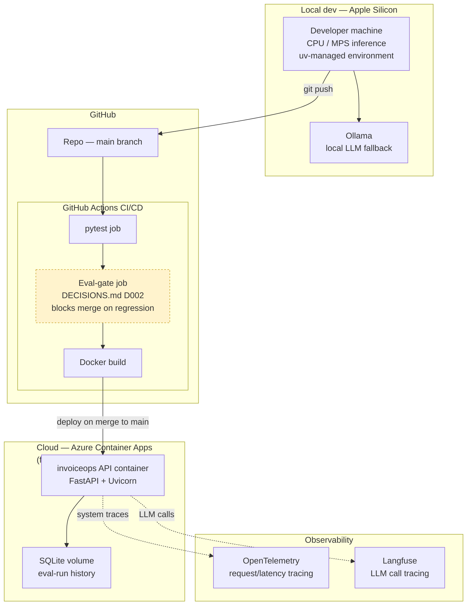

# Deployment Topology

Local dev → CI/CD → cloud runtime. Source: `01-scoping.md` §3 ("REST API, CI with evaluation gate, tracing, cloud deployment") and §8 (local-first, no paid GPU). Stack choices logged in `DECISIONS.md` D004, D008, D009.

## Notes

- No cloud GPU anywhere in this topology — all model inference (Track A embeddings, Track B extraction, Ollama fallback) runs locally during dev and, in the cloud container, on CPU. This is a direct consequence of `01-scoping.md` §8's "no paid GPU" constraint, not an oversight.
- The eval-gate job (yellow, dashed — same convention as elsewhere in this doc set: enforced but easy to get wrong) is what turns D002's evaluator-bug lesson into an actual CI control, not just a written intention.
- SQLite lives on a volume attached to the single API container — acceptable at this scale (`DECISIONS.md` D009); would need to move to a managed DB only if the service were ever split into multiple instances.
