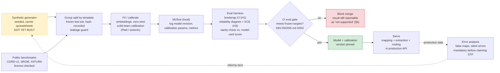

# ML / Data Lifecycle

Data → fit/calibrate → eval gate → registry → serve → error analysis. The data-scientist and ML-engineer view: how a model version earns the right to serve traffic. Source: `01-scoping.md` §5-§7, §9; stack choices in `DECISIONS.md` D005-D007.

## Notes

- **A hypothesis that fails the gate is not a failed project.** `01-scoping.md` §6 explicitly allows "not supported" as a valid, reportable result — `BLOCK` here stops a bad model from merging, it doesn't stop the finding from being written up.
- The loop from error analysis back to the generator is deliberate: false-map and silent-error patterns found in production are exactly the adversarial distractors the synthetic generator (§7) needs to cover, not just a monitoring dead end.
- Nothing in this lifecycle runs without a model version and calibration params logged first (`LOG` before `EVAL`) — this is what makes D002's "reproduce a published score before comparing models" actually enforceable per run, not just a one-time check.
