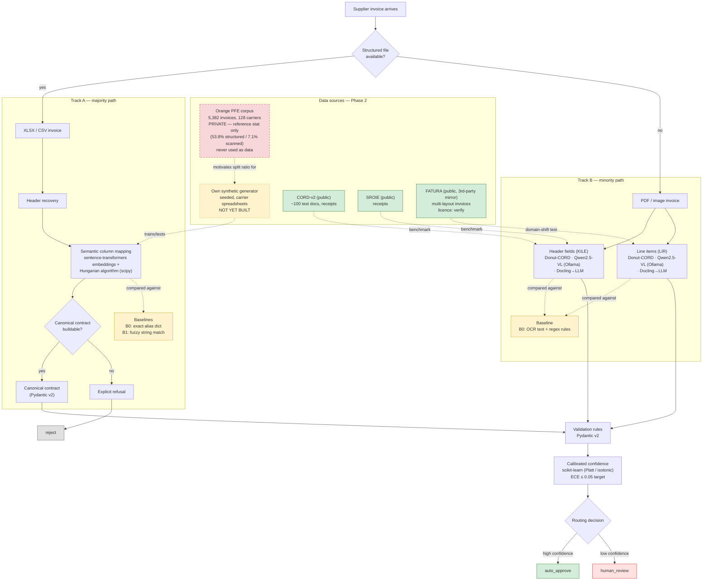

# Pipeline & Data Flow

Track A / Track B request flow, baselines, and current data-source status. Source: `docs/lifecycle/01-scoping.md` §3 (Scope), §5 (Baselines), §7 (Data Plan).

## Reading the diagram

- **Red, dashed** — the private Orange PFE corpus. Motivates the 53.8%/7.1% split ratio used to justify Track A as the majority path, but is never touched as data (per `01-scoping.md` §8 constraints).
- **Yellow, dashed** — planned but not yet built: the synthetic generator (Track A's only real data source) and the two baseline pairs every result gets compared against.
- **Green** — usable today: the 3 public Track B benchmarks (CORD-v2, SROIE, FATURA).
- Track A currently has **no working data path** — the synthetic generator is the blocker before any Track A number is meaningful.
