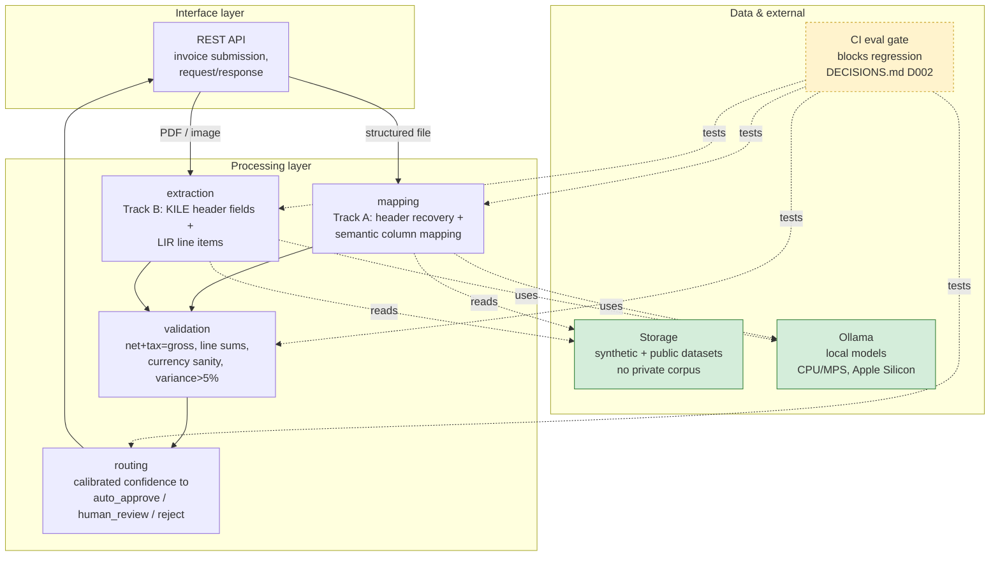

# System Architecture

Module-level component diagram. Maps directly to `src/invoiceops`'s 5 packages (`api`, `extraction`, `mapping`, `routing`, `validation`) — all currently empty skeletons (week 0), so this shows target responsibilities and call direction, not internals.

## Layers

- **Interface** — the REST API (`src/invoiceops/api`). Receives an invoice, dispatches by file type, returns the routing decision.
- **Processing** — the 4 packages doing the actual work: `mapping` (Track A), `extraction` (Track B), `validation` (shared, both tracks), `routing` (shared, final decision).
- **Data & external** — not a package, but what processing depends on: local model inference (Ollama), the data available to train/test against (see [pipeline-data-flow.md](pipeline-data-flow.md) for why storage is green — public/synthetic only, no private corpus), and the CI evaluation gate that tests processing modules on every change.
