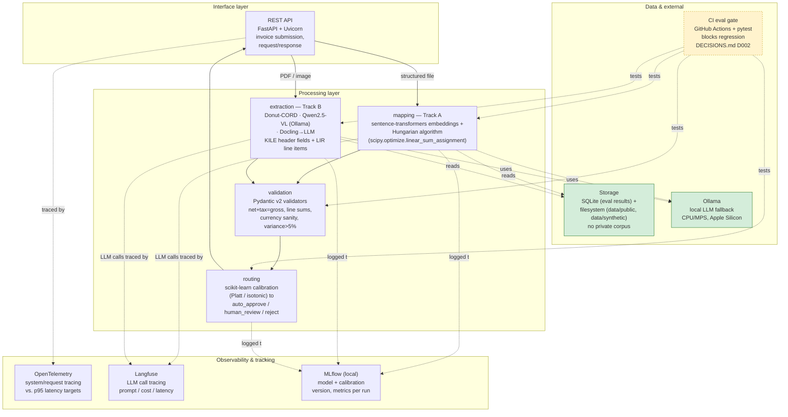

# System Architecture

Module-level component diagram. Maps to `src/invoiceops`'s packages (`api`, `extraction`, `mapping`, `routing`, `validation`, plus `contract` per D011 — see [system design §3](../design/system-design.md#3-components-and-interfaces) for interfaces) — all currently empty skeletons (week 0), so this shows target responsibilities and call direction, not internals.

## Layers

- **Interface** — the REST API (`src/invoiceops/api`), FastAPI + Uvicorn. Receives an invoice, dispatches by file type, returns the routing decision.
- **Processing** — the 4 packages doing the actual work: `mapping` (Track A: embeddings + Hungarian-algorithm assignment), `extraction` (Track B: pretrained HF transformer models on MPS), `validation` (shared, Pydantic validators), `routing` (shared, scikit-learn-calibrated decision).
- **Observability & tracking** — cross-cutting, not a package: OpenTelemetry for system-level request tracing, Langfuse specifically for the LLM/Ollama calls, MLflow for model/calibration versioning tied to every eval run (see `DECISIONS.md` D007-D008 for why these are split).
- **Data & external** — local model inference (Ollama), the data available to train/test against (see [pipeline-data-flow.md](pipeline-data-flow.md) for why storage is green — public/synthetic only, no private corpus), and the CI evaluation gate that tests processing modules on every change.

Stack rationale for every module here is logged in `DECISIONS.md` D004-D009.
