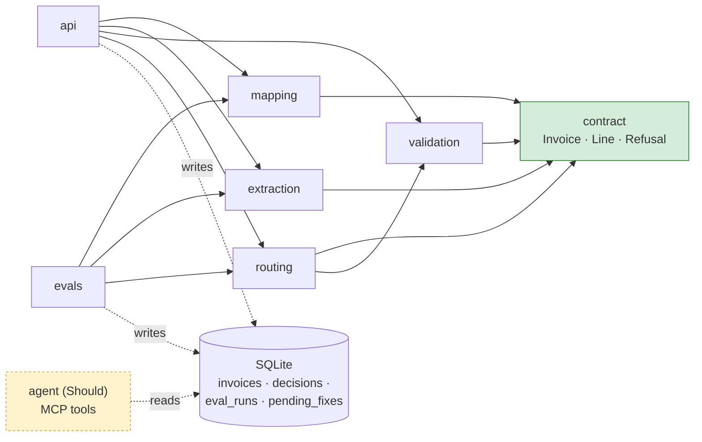
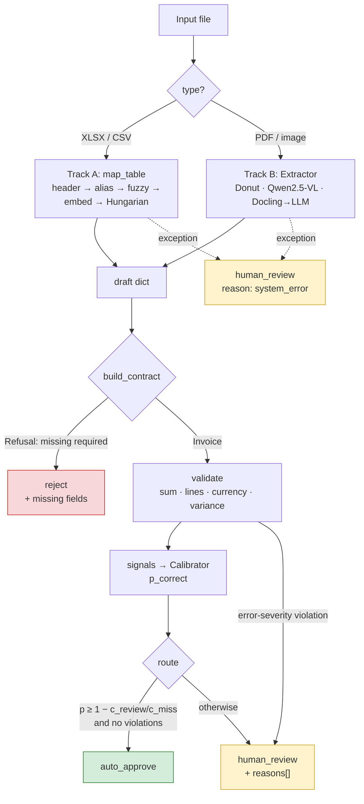
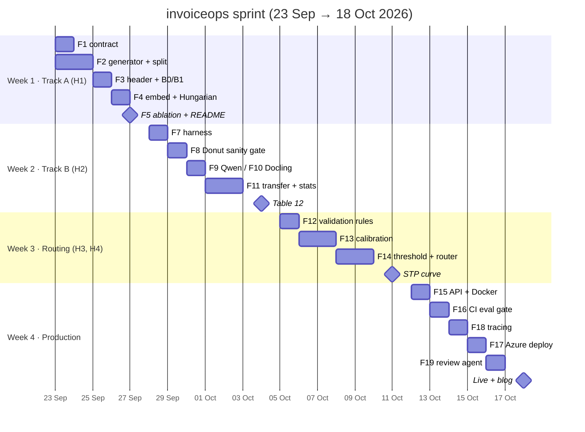
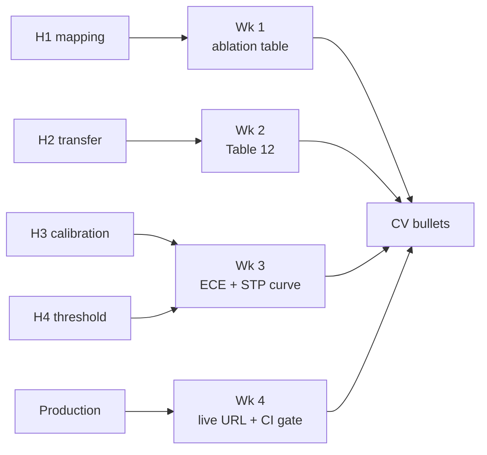

# invoiceops — System Design

> Framework: [Made-With-ML design doc](https://madewithml.com/courses/mlops/product-design/) (Product → System design → Project management), nested inside the ML lifecycle in [`docs/lifecycle/`](../lifecycle/01-scoping.md).
> Status: v1 · 2026-09-23 · Owner: Said Ibenariba
> Metrics, targets, and hypotheses are **not** redefined here. They are pre-registered in [01-scoping.md](../lifecycle/01-scoping.md) §4–§6 and only referenced.

---

## 1. Product

**Objective.** Turn heterogeneous supplier invoices into validated canonical records, and auto-approve only those whose calibrated confidence makes an error cheaper than a human review.

**User and decision.** Accounts-payable / billing reconciliation analyst. Per invoice: `auto_approve` · `human_review` (with reasons) · `reject` (contract cannot be built). See scoping §2.

**Value.**
- User: fewer manual checks (STP ≥ 50%) without silent money errors (≤ 1% undetected).
- Portfolio: public, measured completion of the thesis work — one numeric CV bullet per sprint week.

**Positioning** (from [competitive-analysis.md](../research/competitive-analysis.md)). Commercial IDP (Rossum, Mindee, Azure prebuilt-invoice) optimises PDF extraction. invoiceops targets the **structured-file majority** and makes every routing decision from **calibrated confidence plus an explicit cost rule** — both gaps in open-source tooling.

**Constraints.** Public and synthetic data only (NDA boundary, scoping §8). Local compute: Apple Silicon, Ollama. ~15 h/week build time. Cloud: Azure Container Apps, fallback Hugging Face Spaces (D009, amended).

**Out of scope.** Scoping §3, plus explicitly: a review **UI** (the review agent is the reviewer interface; the API is JSON only) and multi-tenant auth.

---

## 2. System Design

### 2.1 Data

**Track A — synthetic generator** (Faker + openpyxl, seeded).
- 30 carriers × 3 languages (EN/FR/ES) = **90 templates**, 10 invoices each = **900 files**.
- Noise catalogue grounded in the thesis audit: banner rows, abbreviations, pivot blocks, 5 distractor columns per template, per-language header variants.
- Ground truth emitted with every file: column → field mapping and the true canonical record.
- Each invoice also gets an **expected-cost reference**; ~15% carry an injected amount discrepancy (feeds the variance rule and routing labels).

**Split — by carrier**, so language variants of one carrier never straddle train and test (D003, refined in D011):

| Split | Carriers | Templates | Use |
|---|---|---|---|
| dev | 18 | 54 | alias dictionary, τ/m tuning, error analysis |
| calibration | 6 | 18 | fit calibrators |
| test (frozen) | 6 | 18 | all reported numbers; seed + hash in dataset card |

An automated check asserts test carrier IDs ∉ dev ∪ calibration.

**Track B.** CORD-v2 test (100 docs), SROIE test, 200 FATURA invoices. Licences checked in Phase 2. Raw data never committed.

### 2.2 Canonical contract (resolves scoping §11 Q1)

```
Invoice: invoice_no*, supplier_id*, invoice_date*, currency* (ISO 4217),
         period_start, period_end, net*, tax, gross*, lines[≥1]*
Line:    charge_type* (enum), amount*, quantity, unit_price, description
```

`*` = required. Any required field missing → `Refusal(reason, missing)`.
`tax` is optional because wholesale telecom is often reverse-charged, but a missing `tax` is allowed only when `gross == net`; otherwise the contract refuses.

### 2.3 Labeling

No manual annotation.
- Track A: labels produced by the generator.
- Track B: public dataset labels.
- Routing target: `record_correct: bool` — every required field matches ground truth after normalisation. Derived automatically; it is the label the calibrators fit.

### 2.4 Processing

- **Track A.** Header-row recovery (score rows by text density; skip banners) → cascade stages, each producing a `columns × fields` score matrix → combined matrix → Hungarian one-to-one assignment. A column is accepted only if `score ≥ τ` **and** `margin ≥ m`, else unmapped. An unmapped required field → refusal.
- **Track B.** One adapter per model, each emitting the same contract draft, so one normaliser and one scorer serve every model.

### 2.5 Learning

No model training.
- Alias dictionary and τ, m tuned on **dev**.
- Calibrators (Platt / isotonic) fit on **calibration**.
- Track B models used pretrained or zero-shot.

### 2.6 Evaluation

- Metrics and targets: scoping §4. Baselines: §5. Hypotheses: §6.
- Bootstrap CIs **clustered by carrier** (invoices of one carrier are not independent).
- Model comparisons: paired bootstrap on F1 differences + McNemar per field.
- **Harness gate:** Donut-CORD must reproduce its model-card score within 0.05 before any model comparison is reported (D002).
- Error analysis: 50 failures → taxonomy.

### 2.7 Decision rule (resolves scoping §11 Q2, Q3)

- Approve iff `p_correct ≥ 1 − c_review / c_miss` and no error-severity violation.
- Default `c_miss : c_review = 50 : 1` → threshold 0.98. Sensitivity sweep over 10 : 1 … 200 : 1.
- Variance flag: `|invoice − expected| > 5%` **and** `> 10` currency units (avoids flagging rounding on small invoices).

### 2.8 Inference

Batch CLI for evals; FastAPI for serving; one process (D004). Track B runs synchronously — at a 5 s p95 target, a queue is not justified.

### 2.9 Iteration

| Version | Content | Hypothesis |
|---|---|---|
| v0 | baselines B0/B1, R0/R1 | — |
| v1 | mapping cascade | H1 |
| v2 | Track B matrix (Table 12) | H2 |
| v3 | calibration + routing | H3, H4 |
| v4 | API, CI gate, deploy, agent | — |

One tagged release per version.

---

## 3. Components and Interfaces

One public entry point per module. Modules exchange typed Pydantic values; none reaches into another's internals.

```
contract/     Invoice, Line, ChargeType, Refusal(reason, missing: list[str])
              build_contract(draft: dict) -> Invoice | Refusal

mapping/      map_table(path) -> MappingResult
                header_row, assignments{col→field}, scores, margins, unmapped
              to_draft(path, MappingResult) -> dict
              stages: alias, fuzzy, embed, assign, [llm_tiebreak]   # pluggable; ablation = on/off list

extraction/   Extractor (Protocol): extract(path) -> ExtractionResult
                draft: dict, field_conf: dict[str, float], latency_ms, cost_usd
              DonutExtractor, QwenVLExtractor, DoclingLLMExtractor

validation/   validate(inv: Invoice, expected: Decimal | None) -> list[Violation]
                Violation(rule, severity, detail)   # sum, lines, currency, variance

routing/      signals(...) -> ConfidenceSignals     # A: min margin on required fields, n_unmapped; B: min field_conf
              Calibrator.load(version).predict(signals) -> p_correct
              route(p_correct, violations, cost_ratio) -> Decision(action, p_correct, reasons[])

evals/        one runner per hypothesis: h1_mapping, h2_transfer, h3_calibration, h4_routing
              → SQLite eval_runs(run_id, git_sha, data_hash, component, metric, value, ci_lo, ci_hi) + MLflow

api/          POST /extract   file → Invoice | Refusal (+ signals)
              POST /validate  Invoice → Violations
              POST /route     Invoice + signals → Decision
              POST /process   file → full pipeline (demo endpoint)

agent/        (Should) MCP tools: get_invoice, query_lines (read-only SQL), explain_flags,
              propose_mapping_fix → pending_fixes; applied only after human approval
```

The contract lives in its own package (D011): both tracks produce it; validation, routing and the API consume it; neither track depends on the other.

### 3.1 Module dependencies



### 3.2 Per-invoice data flow



Exactly one path reaches `auto_approve`: contract built, no error-severity violation, calibrated `p_correct` above the cost threshold.

### 3.3 Error handling

- `Refusal` and `Violation` are **returned values**, never raised.
- Exceptions are reserved for I/O and model failures; the pipeline catches them and routes to `human_review` with reason `system_error`. No failure path can auto-approve.
- Every `Decision` carries `reasons[]` — the audit trail and the review agent's input.

### 3.4 Testing

- Unit: contract rules, each cascade stage, each validation rule, metrics on hand-built cases (D002).
- Property tests on the generator: ground truth always consistent with the invoice's own totals.
- API tests.
- CI smoke eval on a small frozen subset; the build fails on regression beyond CI bounds.

---

## 4. Project Management

### 4.1 Backlog (MoSCoW)

| ID | Feature | Priority | Week | Done when |
|---|---|---|---|---|
| F1 | `contract/` package (Invoice, Line, Refusal) | Must | 1 | Tests: required fields, refusal reasons, tax rule. Replaces `validation/output_contractor.py` |
| F2 | Synthetic generator + carrier split + dataset card | Must | 1 | 900 files, seeded; test hash recorded; leakage check and property tests pass |
| F3 | Header recovery + alias/fuzzy stages (B0, B1) | Must | 1 | Baseline numbers in `eval_runs` |
| F4 | Embedding + Hungarian stages, τ/m gate | Must | 1 | One-to-one enforced; refusal on unmapped required field |
| F5 | H1 ablation eval (clustered bootstrap CI) | Must | 1 | README table: accuracy + false-map rate per stage; 0 silent errors |
| F6 | LLM tie-break stage | Could | 1 | Low-margin columns only; structured output |
| F7 | Track B harness: normaliser, KILE/LIR F1, latency | Must | 2 | Metric unit tests on hand-made cases |
| F8 | Donut-CORD sanity gate | Must | 2 | Within 0.05 of card score, else stop and debug the harness |
| F9 | Qwen2.5-VL adapter (Ollama) | Must | 2 | Scored on CORD + FATURA |
| F10 | Docling→LLM adapter | Should | 2 | Scored on CORD + FATURA |
| F11 | H2 transfer test + stats + error taxonomy | Must | 2 | Table 12 filled with CIs; McNemar per field; 50-failure taxonomy |
| F12 | Validation rules | Must | 3 | 4 rules, each with passing and failing tests |
| F13 | Confidence signals + calibration (H3) | Must | 3 | Reliability diagrams; ECE before → after per track |
| F14 | Cost threshold + router (H4) | Must | 3 | STP–error curve; cost-ratio sweep; STP at ≤ 1% error reported |
| F15 | FastAPI + Docker | Must | 4 | 4 endpoints; API tests; multi-stage image |
| F16 | CI eval gate | Must | 4 | A deliberately bad threshold PR is blocked (screenshot) |
| F17 | Azure Container Apps deploy | Must | 4 | Live URL; fallback HF Spaces |
| F18 | Tracing: OpenTelemetry + Langfuse | Should | 4 | p95 and cost per invoice visible |
| F19 | Review agent (LangGraph + MCP) | Should | 4 | 20 scripted cases, ≥ 80% correct, 0 writes without approval |
| F20 | Drift check | Could | 4 | Alert on confidence drop ≥ 10 pts |
| F21 | Blog post + CV bullets | Should | 4 | Published; `cv.md` updated |

**Won't (this sprint):** LayoutLMv3 fine-tuning, review UI, Kubernetes, Postgres, auth.

**Cut order on slip:** F6 → F20 → F10 → Langfuse (keep OpenTelemetry) → F19.

**Week 1 cut already applied** (D010): LLM tie-break demoted to Could. Carrier count stays 30 (10 invoices each), since 3 test carriers made the carrier-clustered bootstrap degenerate.

### 4.2 Timeline



---

## 5. Traceability

Every Must feature serves a hypothesis or a production exit criterion; every hypothesis ends in a CV bullet.

| Hypothesis / goal | Features | Metric (scoping §4) | Week-end artefact |
|---|---|---|---|
| H1 — embeddings + assignment beat fuzzy | F1–F5 (F6) | mapping accuracy, false-map rate, silent errors | ablation table |
| H2 — benchmark scores don't transfer | F7–F11 | KILE / LIR F1, transfer gap, p95, cost/page | Table 12 |
| H3 — raw confidence is miscalibrated | F13 | ECE before → after | reliability diagrams |
| H4 — cost threshold gives safe automation | F12, F14 | STP at ≤ 1% undetected error | STP–error curve |
| Production | F15–F19 | p95, $/1k invoices, regression blocked, agent success | live URL + CI badge |



---

## Related Decisions

D001–D009 in [DECISIONS.md](../../DECISIONS.md), plus from this design: D006 and D009 amended, D010 (Week 1 scope cut), D011 (contract package, split by carrier).
